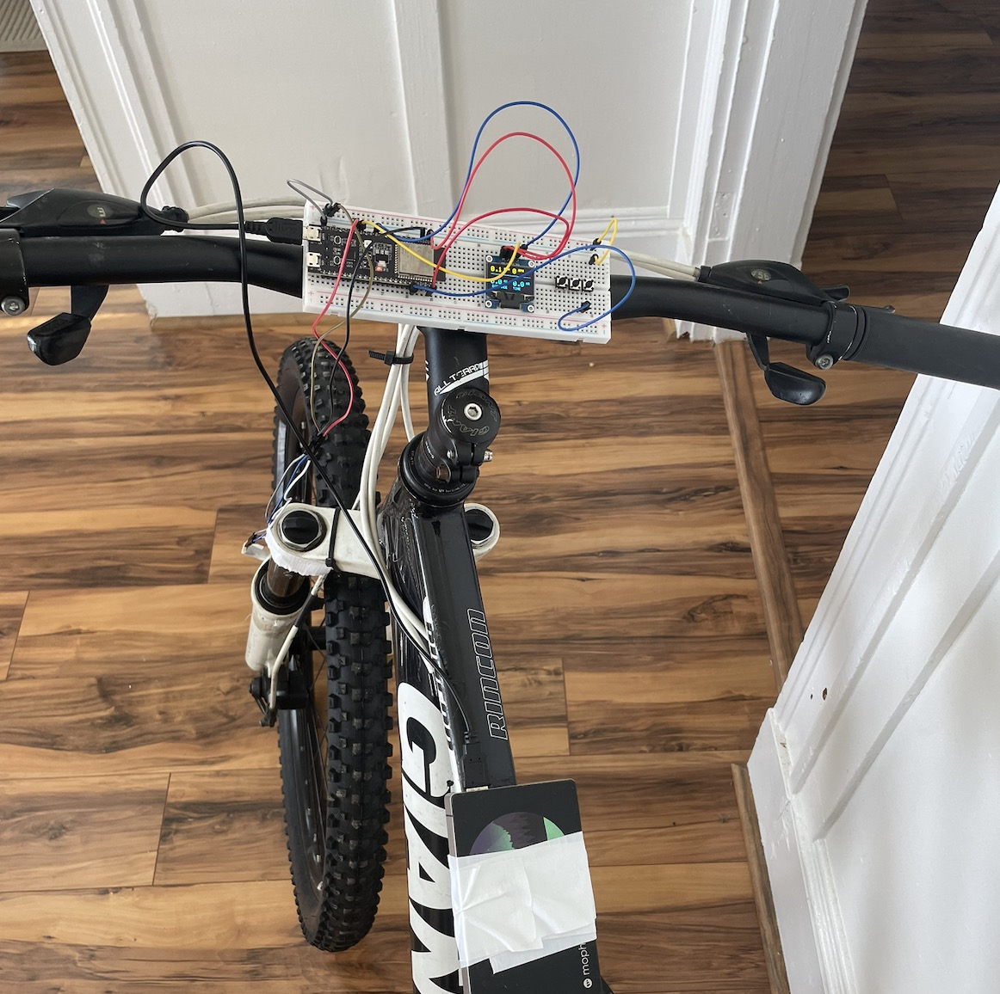
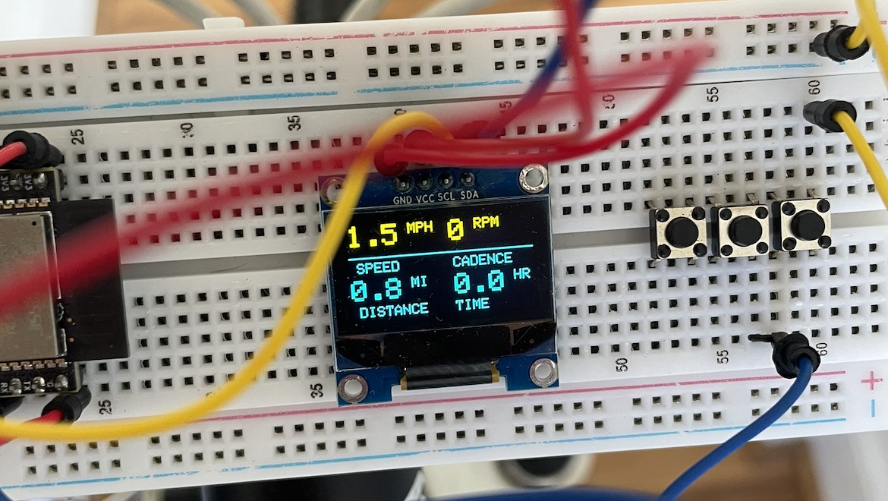

# Momentum
Momentum is a lightweight open source bike computer for an ESP32 microcontroller. It measures speed and distance using a halls effect sensor and writes to a 0.96 OLED display with button navigation between the welcome screen and the metrics dashboard.

| Component | Model | Purpose |
|---|---|---|
| Microcontroller | ESP32-S3-DevKitC-1 | Main controller |
| Display | SSD1306 OLED | User interface |
| Speed Sensor | Hall-effect sensor | Wheel rotation detection |
| Magnet | Wheel-mounted magnet | Triggers Hall sensor |
| Wiring | Jumper wires | Electrical connections |
| Push Button | Momentary push button | Navigates between home and metrics screens |

| ESP32-S3 Pin | Component | Connection |
|---|---|---|
| 3.3V | OLED | VCC |
| GND | OLED | GND |
| GPIO 1* | Push Button | Button Signal (INPUT_PULLUP) |
| GPIO 8* | OLED | SDA |
| GPIO 9* | OLED | SCL |
| GPIO 10* | Hall Sensor | Signal |

